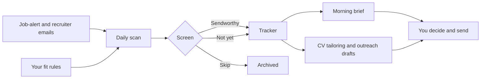

# ApplySteward

**AI job-search aide.** Looks after your applications. You make the calls.

ApplySteward is a set of skills, prompts and a tracker that turns your own AI subscription into a calm, daily job-search assistant. It reads your job-alert emails, screens every role against rules you set, keeps your tracker up to date, drafts tailored CVs and messages, and sends you a short morning brief with three actions for the day.

It never applies on your behalf. It tells you what is worth sending, prepares it, and you press send.

> Works with Claude. ApplySteward is an independent project and is not affiliated with or endorsed by Anthropic.

---

## Why it exists

Applications per job have exploded since AI tools made mass-applying easy. Recruiters now filter harder, and auto-apply bots mostly add noise. The people who get hired are the ones who apply to fewer, better-matched roles and follow up properly.

ApplySteward is built for that. It is for anyone who applies heavily online, in any career, rather than relying on executive headhunters.

## What it does

| Every day | On demand |
|---|---|
| Reads new job-alert and recruiter emails | Tailors your CV to a specific role (never invents experience) |
| Screens each role against your rules | Drafts outreach to recruiters, hiring managers and referrals |
| Marks each one **Sendworthy**, **Not yet** or **Skip** | Runs mock interviews and builds your STAR story bank |
| Logs everything in your tracker | Reviews rejection patterns weekly |
| Sends a short brief: new fits, three actions, who you're waiting on | Reminds you when a follow-up is due |

## How it works



1. **Setup wizard.** A six-minute form at [applysteward.com](https://applysteward.com) sets your lanes, salary floor, location, deal-breakers and red flags, then hands you your fit-rules file. It also suggests small changes that make the system work better, such as using Gmail for job alerts, and lets you skip any of them. Nothing you type leaves your browser.
2. **Daily scan.** A scheduled task reads new alerts, screens them and updates the tracker.
3. **Morning brief.** Delivered by email to yourself or to a Slack channel.
4. **You act.** Tailored CVs and draft messages are ready. You review, edit and send.

## Design principles

- **Human sends.** No auto-apply, no automated LinkedIn browsing, no messages sent without you.
- **Never invent.** Tailoring only rearranges and rephrases what is true. Gaps are flagged, not filled.
- **Low noise.** Three actions a day beats a dashboard of fifty rows.
- **Your data stays yours.** Everything runs inside your own AI account and your own spreadsheet. ApplySteward has no servers and never sees your inbox or CV.
- **One fee, no subscription.**

## Requirements

- A paid Claude plan (scheduled tasks and connectors need one)
- A Gmail account for job alerts (other providers can forward alerts to Gmail)
- Google Sheets for the tracker
- Optional: a free Slack workspace for the morning brief

Feature availability on AI plans changes often. The setup guide lists what to check before you start.

## Free and Pro

This repository is the free core. It is enough to see how ApplySteward thinks and to run the screening loop by hand.

| | Free (this repo) | Pro |
|---|---|---|
| Setup wizard and fit-rules file | Yes | Yes |
| Tracker template | Yes | Yes |
| Manual `/scan` skill (paste emails, get verdicts) | Yes | Yes |
| Outreach drafts skill | Yes | Yes |
| Weekly rejection review | Yes | Yes |
| Calibration interview that tunes your rules from your first scans | | Yes |
| Scheduled daily scan and morning brief | | Yes |
| CV tailoring to Word and PDF | | Yes |
| Interview practice and story bank | | Yes |
| Career lane packs (sales, product, engineering, finance, HR, operations, healthcare, education) | | Yes |
| Setup guide and video walkthroughs | | Yes |
| 12 months of updates | | Yes |

**Pro is a one-time £49.** A £129 option adds a 45-minute screen-share setup call.
Link: _coming soon_

## Install the free core

### Option A: claude.ai (web or desktop)

1. Create your fit rules with the setup wizard at [applysteward.com](https://applysteward.com).
2. Download the latest release zip from the Releases page.
3. In Claude, open the skills settings and upload each folder inside `skills/`.
4. Create a Claude project and add your `fit-rules.md` to it.
5. Import `templates/tracker.csv` into Google Sheets.
6. In a chat inside that project, type `/scan` and paste a few job-alert emails.

### Option B: Claude Code

```bash
/plugin marketplace add yserrag/applysteward
/plugin install applysteward
```

Then run `/scan` in any session.

## Repository layout

```
applysteward/
├── README.md
├── LICENSE                     # PolyForm Noncommercial 1.0.0
├── .claude-plugin/
│   ├── plugin.json             # Claude Code plugin manifest
│   └── marketplace.json        # Lets Claude Code install from this repo
├── skills/
│   ├── scan/SKILL.md           # Screen job emails against your fit rules
│   ├── outreach/SKILL.md       # Recruiter, hiring-manager, referral and follow-up drafts
│   └── rejection-review/SKILL.md  # Weekly look at what is and isn't working
├── templates/
│   ├── fit-rules.md            # Blank rules file, if you'd rather not use the wizard
│   ├── tracker.csv             # Tracker columns (import into Google Sheets)
│   └── brief-example.md        # What a morning brief looks like
└── docs/                       # The setup wizard, served at applysteward.com
    ├── index.html
    └── CNAME
```

## FAQ

**Does it apply to jobs for me?**
No. It screens, tracks, tailors and drafts. You send. This protects your reputation and your accounts on job sites.

**Will it get me a job?**
No tool can promise that. ApplySteward saves time on admin and helps you focus on roles worth your effort. Results depend on you and the market.

**Do you see my emails or CV?**
No. Everything runs inside your own AI account and spreadsheet.

**Does it work with ChatGPT?**
Not yet. A lighter ChatGPT version may follow.

**Can I get a refund?**
Pro comes with a 14-day "it didn't work for me" refund.

## Licence

The free core is released under the [PolyForm Noncommercial License 1.0.0](https://polyformproject.org/licenses/noncommercial/1.0.0/). Personal use is welcome. Reselling or bundling it in a paid product is not permitted without permission.

ApplySteward Pro is sold separately under its own licence.

## About

Built by [Yousef Serrag](https://linkedin.com/in/yserrag) while running his own job search with it, every day. Feedback and issues are welcome.
