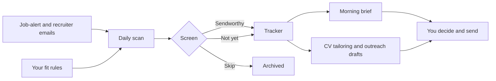

# ApplySteward™

> **© 2026 Yousef Serrag. All rights reserved.** ApplySteward™ is proprietary. You may use it for your own job search only. Copying, adapting, reselling or redistributing any part of it, or using it in a commercial product or service, is not permitted without written permission. See [Licence and permitted use](#licence-and-permitted-use).

**AI job-search aide.** Looks after your applications. You make the calls.

ApplySteward is a set of skills, prompts and a tracker that turns your own AI subscription into a calm, daily job-search assistant. It reads your job-alert emails, screens every role against rules you set, keeps your tracker up to date, drafts tailored CVs and messages, and sends you a short morning brief with three actions for the day.

It never applies on your behalf. It tells you what is worth sending, prepares it, and you press send.

> Works with Claude. ApplySteward is an independent project and is not affiliated with or endorsed by Anthropic.

---

## Why it exists

Applications per job have exploded since AI tools made mass-applying easy. Recruiters now filter harder, and auto-apply bots mostly add noise. The people who get hired are the ones who apply to fewer, better-matched roles and follow up properly.

ApplySteward is built for that. It is for anyone who applies heavily online, in any career, rather than relying on executive headhunters.

## What it does

| Every day | On demand |
|---|---|
| Reads new job-alert and recruiter emails | Tailors your CV to a specific role (never invents experience) |
| Screens each role against your rules | Drafts outreach to recruiters, hiring managers and referrals |
| Marks each one **Sendworthy**, **Not yet** or **Skip** | Runs mock interviews and builds your STAR story bank |
| Logs everything in your tracker | Reviews rejection patterns weekly |
| Sends a short brief: new fits, three actions, who you're waiting on | Reminds you when a follow-up is due |

## How it works



1. **Setup wizard.** A six-minute form at [applysteward.com](https://applysteward.com) sets your lanes, salary floor, location, deal-breakers and red flags, then hands you your fit-rules file. It also suggests small changes that make the system work better, such as using Gmail for job alerts, and lets you skip any of them. Nothing you type leaves your browser.
2. **Daily scan.** A scheduled task reads new alerts, screens them and updates the tracker.
3. **Morning brief.** Delivered by email to yourself or to a Slack channel.
4. **You act.** Tailored CVs and draft messages are ready. You review, edit and send.

## Design principles

- **Human sends.** No auto-apply, no automated LinkedIn browsing, no messages sent without you.
- **Never invent.** Tailoring only rearranges and rephrases what is true. Gaps are flagged, not filled.
- **Low noise.** Three actions a day beats a dashboard of fifty rows.
- **Your data stays yours.** Everything runs inside your own AI account and your own spreadsheet. ApplySteward has no servers and never sees your inbox or CV.
- **Free while in testing.** No account, no card, no subscription.

## Requirements

To start, you only need an AI assistant. Claude, ChatGPT, Gemini and Microsoft Copilot all work, and free plans are enough. Your tracker lives on [your desk](https://applysteward.com/desk/) in your browser, so no spreadsheet is needed.

The automatic daily scan and morning brief are on the roadmap. When they arrive, they will also need:

- A paid Claude plan (scheduled tasks and connectors need one)
- A Gmail account for job alerts (other providers can forward alerts to Gmail)
- Optional: a free Slack workspace for the morning brief

Feature availability on AI plans changes often. The setup guide lists what to check before you start.

## What's included

Everything here is free for personal use while ApplySteward is being tested.

- Setup wizard and your fit-rules file
- Any-AI guide for ChatGPT, Gemini and Copilot
- Your desk: your tracker, today's actions, follow-ups due, daily aim and application packs
- `/scan`: paste job alerts, get Sendworthy, Not yet or Skip with reasons
- Outreach drafts and application packs for long online forms
- Weekly review of how your search is going
- Interview practice for a specific role, with feedback
- Help with pay questions and replying to an offer
- Rule changes suggested when a verdict is wrong

### On the roadmap

Ideas being explored, with no dates or prices yet. Tell me which would help you most.

- A calibration interview that tunes your rules from your first scans
- An automatic daily scan and morning brief (needs a paid Claude plan)
- CV tailoring to Word and PDF
- A story bank for interviews
- Career packs for sales, product, engineering, finance, HR, operations, healthcare and education
- Video walkthroughs

## Install the free core

### Simplest: nothing to install

Finish the setup wizard at [applysteward.com](https://applysteward.com) and click **Copy my setup**. Paste it into a new chat in Claude, ChatGPT, Gemini or Copilot, then paste a few job alerts. That is the whole setup. The options below save it permanently, so you don't paste it into each new chat.

### Option A: claude.ai (web or desktop)

1. Create your fit rules with the setup wizard at [applysteward.com](https://applysteward.com).
2. Download this repository: on its GitHub page, click the green **Code** button, then **Download ZIP**, and unzip it.
3. In Claude, open the skills settings and upload each folder inside `skills/`.
4. Create a Claude project and add your `fit-rules.md` to it.
5. Open [your desk](https://applysteward.com/desk/) and click **Start my tracker** (or import `templates/tracker.csv` into a spreadsheet if you prefer).
6. In a chat inside that project, type `/scan` and paste a few job-alert emails, then paste the table or the rows it gives you into your desk.

### Option B: Claude Code

```bash
/plugin marketplace add yserrag/applysteward
/plugin install applysteward
```

Then run `/scan` in any session.

## Repository layout

```
applysteward/
├── README.md
├── LICENSE                     # Licence: personal use only, all other rights reserved
├── .claude-plugin/
│   ├── plugin.json             # Claude Code plugin manifest
│   └── marketplace.json        # Lets Claude Code install from this repo
├── skills/
│   ├── scan/SKILL.md           # Screen job emails against your fit rules
│   ├── outreach/SKILL.md       # Recruiter, hiring-manager, referral and follow-up drafts
│   ├── practise/SKILL.md           # Practice interview for a specific role, with feedback
│   ├── pay/SKILL.md                # What to say about pay, and how to reply to an offer
│   └── rejection-review/SKILL.md  # Weekly look at what is and isn't working
├── templates/
│   ├── fit-rules.md            # Blank rules file, if you'd rather not use the wizard
│   ├── tracker.csv             # Tracker columns (import into Google Sheets)
│   └── brief-example.md        # What a morning brief looks like
├── any-ai/                     # Copy-and-paste setup for ChatGPT, Gemini and Copilot
│   ├── README.md
│   └── instructions.md
└── docs/                       # The setup wizard, served at applysteward.com
    ├── index.html
    └── CNAME
```

## FAQ

**Does it apply to jobs for me?**
No. It screens, tracks, tailors and drafts. You send. This protects your reputation and your accounts on job sites.

**Will it get me a job?**
No tool can promise that. ApplySteward saves time on admin and helps you focus on roles worth your effort. Results depend on you and the market.

**Do you see my emails or CV?**
No. Everything runs inside your own AI account and spreadsheet.

**Does it work with ChatGPT, Gemini or Copilot?**
Yes. The wizard and rules file work with any AI, and the [any-AI guide](any-ai/) sets up screening, outreach drafts and weekly reviews in ChatGPT, Gemini or Copilot in about five minutes. Automatic daily scans of your inbox currently need Claude.

**Which job boards should I use?**
The setup wizard suggests the main boards for your country and any specialist ones for your field, such as NHS Jobs, eFinancialCareers or Tes. Set up daily email alerts on those, and your aide does the sorting.

**I'm new to AI. Is this for me?**
Yes. You type in plain English and stay in charge of every decision. Free plans are enough to start.

**Is it really free?**
Yes, while I test it. No account, no card and no subscription. Honest feedback is all I ask for.

## Licence and permitted use

© 2026 Yousef Serrag. All rights reserved. ApplySteward™, including its name, website, design, skills, instructions and templates, is protected by copyright.

**You may:** download and use ApplySteward for your own personal job search.

**You may not**, without written permission:
- copy, adapt or republish any part of it, including the skills, instructions or website;
- sell, resell, bundle or sublicense it, or include it in any paid or commercial product or service;
- offer it, or anything derived from it, to clients, employees or customers;
- use the ApplySteward name or anything confusingly similar.

The full terms are in [LICENSE](LICENSE). For permission, including coaching, outplacement or team licences, contact Yousef Serrag via [LinkedIn](https://linkedin.com/in/yserrag).


## Why I built this

I've been learning to build with AI, and I wanted to put it to work on something that genuinely helps people. Job hunting is stressful, and wading through endless job alerts makes it harder, so I built ApplySteward.

It's free while I test it. That's my win/win/win: you get calm, practical help at a hard time, more people get comfortable using AI in their own way, and I keep learning from what you tell me.

If ApplySteward helps you, I would love to hear about it. Please let me know on [LinkedIn](https://www.linkedin.com/in/yserrag), along with anything that could be better.

[Yousef Serrag](https://linkedin.com/in/yserrag)
